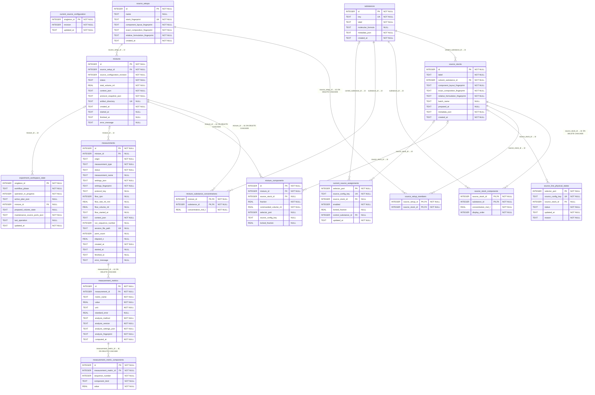

# Experiment database ERD

> Generated from the live SQLite schema by `python scripts/generate_database_erd.py`. Do not edit manually.

Schema version: `1` (code supports `1`).

## Interpretation notes

- PalmSens session files remain the source of raw curve data; the database stores their paths, experimental context, and derived metrics.
- `current_source_configuration` is a singleton revision counter. `current_source_assignments` holds the editable port assignments.
- Source-setup identity is based on enabled stock identities, not port order. A mixture records the exact stock fractions and ports used.
- A mixture may have multiple measurements, and a measurement may have multiple versioned analysis metrics.

## Composite uniqueness constraints

- `measurement_metric_components(measurement_metric_id, component_kind, sequence_number)`
- `measurement_metrics(measurement_id, metric_name, analysis_method, analysis_version, analysis_fingerprint)`
- `measurements(mixture_id, run_sequence_number)`
- `mixture_components(mixture_id, selector_port)`
- `mixture_components(mixture_id, source_config_key)`
- `source_stock_components(source_stock_id, display_order)`
